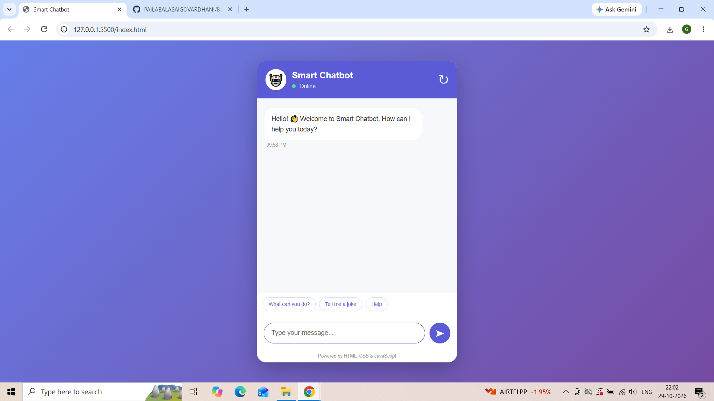
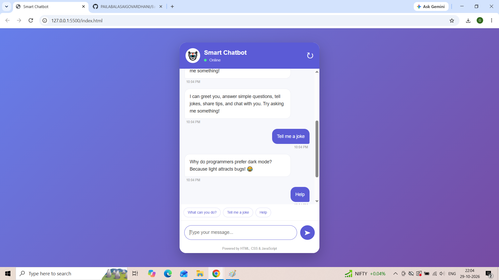
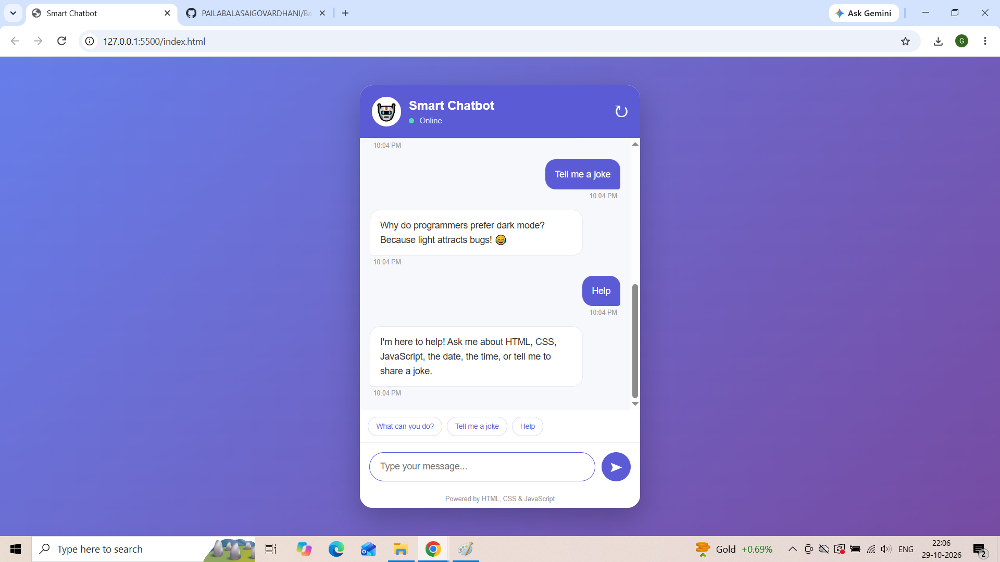

# 🤖Chatbot Web Application


## 📌 About The Project

The Chatbot Web Application is an interactive web-based project developed using HTML, CSS, and JavaScript.

This application provides a simple and user-friendly interface where users can enter their questions or messages and receive responses from the chatbot.

The main goal of this project is to understand frontend development concepts and create an interactive web application.

## 🎯 Project Objectives

- Develop an interactive chatbot interface.
- Create a responsive and attractive user interface.
- Understand JavaScript functionality.
- Implement user message handling.
- Display chatbot responses dynamically.
- Improve frontend development skills.

## ✨ Features

- 🤖 Interactive chatbot interface.
- 💬 User message input.
- ⚡ Dynamic chatbot responses.
- 🎨 Attractive user interface.
- 📱 Responsive design (if implemented).
- ⌨️ Send messages using the Enter key (if implemented).
- 🔄 Continuous conversation.

## 🛠️ Technologies Used

| Technology | Purpose |
|---|---|
| HTML5 | Structure of the application |
| CSS3 | Styling and layout |
| JavaScript | Chatbot functionality |

### HTML5
HTML5 is used to create the basic structure and content of the Chatbot Web Application.

Role of HTML in this project:

Creates the main chatbot layout.

Defines the chatbot header and title.

Creates the message display section.

Provides an input field for users to type messages.

Adds a Send button to submit messages.

Organizes different sections of the chatbot interface.

### CSS3
CSS3 is used to design and style the chatbot application, making it attractive, clean, and user-friendly.

Role of CSS in this project:

Designs the overall chatbot interface.

Adds background colors and attractive visual effects.

Styles the chat window and message bubbles.

Customizes buttons and input fields.

Adds spacing, borders, shadows, and animations.

Improves the visual appearance on different screen sizes

### JavaScript
JavaScript is used to implement the functionality and interactive features of the chatbot application.

Role of JavaScript in this project:

Captures messages entered by users.

Handles user interactions and button clicks.

Processes the messages entered in the chatbot.

Generates chatbot responses based on programmed logic.

Displays user messages and chatbot replies dynamically.

Updates the conversation without refreshing the webpage.

Manages the chatbot's interactive behavior.


## ⚙️ How Does It Work?

1. The user opens the chatbot application.
2. The chatbot interface appears on the screen.
3. The user enters a question or message.
4. JavaScript captures the user's input.
5. The chatbot processes the message using its programmed logic.
6. A response is generated.
7. The response is displayed in the chat window.
8. The user can continue interacting with the chatbot.

## 📸 Screenshots

### 1. Chatbot Home Page


### 2. Chatbot Conversation


### 3. Chatbot Interface


## 📂 Project Structure


Chatbot_project/
│
├── index.html
├── style.css
├── script.js
├── README.md
│
└── screenshots/
    ├── chatbot-home.png
    ├── chatbot-conversation.png
    └── chatbot-interface.png
```

## 🚀 How to Run the Project

**Step 1:** Clone the repository.
```bash
git clone https://github.com/PAILABALASAIGOVARDHANI/Basic-Smart-Chatbot
```

**Step 2:** Open the project folder in VS Code.

**Step 3:** Open `index.html` in your browser.

**Step 4:** Enter a message in the chatbot input box.

**Step 5:** Click the Send button and view the response.

## 📚 What I Learned

While developing this project, I learned:

- HTML webpage structure.
- CSS styling and layouts.
- JavaScript fundamentals.
- DOM manipulation.
- Event handling.
- Interactive web development.
- Project management using Git and GitHub.

## 🔮 Future Enhancements

- Integrate an AI API for intelligent responses.
- Add voice recognition.
- Add voice-based responses.
- Implement chat history.
- Support multiple languages.
- Improve chatbot design and responsiveness.

## 👩‍💻 Author

**PAILA BALA SAI GOVARDHANI**

Frontend Development Learner

## 🔗 Connect With Me

- GitHub: https://github.com/PAILABALASAIGOVARDHANI
- LinkedIn: https://www.linkedin.com/in/balasaigovardhani-paila/

## 📄 License

This project is created for educational and learning purposes.

---

<p align="center">
  ⭐ If you like this project, consider giving it a star!
</p>

<p align="center">
  **Thank You for Visiting My Project! ❤️**
</p>